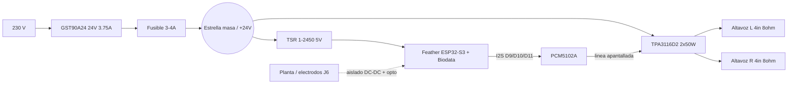

# Biodata en escultura con sonido propio y altavoces

*Revisión de la carpeta `Proyectos/BiodataFeather` de Nextcloud (zip descargado y descomprimido en `/workspace/biodata_escultura/src/BiodataFeather`). 11 nov 2026.*

Convención del documento:
- **[ARCHIVOS]**: dato sacado de los ficheros (se indica la ruta).
- **[RECOMENDACIÓN]**: propuesta mía, no está en los ficheros.

---

## 1. Resumen rápido

- **Placa [ARCHIVOS]:** **Adafruit Feather ESP32-S3** (BOM de MolinoLab: Adafruit 5323, *ESP32-S3 Feather 8MB/0MB PSRAM*). El ESP32-S3 **no tiene DAC**, así que el audio tiene que salir por **I2S** hacia un DAC externo.
- **¿Basta la info que hay?** Para el **hardware** sí: esquema, pines, alimentación y aislamiento del sensor están documentados. Para el **sonido en la propia placa**, no: no hay ninguna línea de código de audio, DAC, I2S, Mozzi ni síntesis en el firmware. La única síntesis está en la web app (`App/biodata-wave-web`, Web Audio en el navegador). La v12 no está ni en la carpeta, ni en el historial git, ni en GitHub.
- **Cadena recomendada [RECOMENDACIÓN]:**
  1. Feather ESP32-S3 → I2S → **DAC PCM5102A** (salida de línea estéreo).
  2. → **amplificador clase D TPA3116D2** (módulo XH-M189) alimentado a **24 V**.
  3. → **2 altavoces de banda ancha de 4" (10 cm), 8 Ω**, cada uno en una caja cerrada de unos 4–6 L integrada en la escultura.
  4. **Una sola fuente de 24 V** (Mean Well GST90A24, de sobremesa y cerrada) y un regulador de **5 V** (TRACO TSR 1-2450) para el Feather.
- **Coste aproximado** de la parte de audio y alimentación: **unos 105–120 €** sin contar madera ni la placa Feather.

---

## 2. Qué hay en los archivos

### 2.1 Placa y módulo ESP32

| Hecho | Fuente |
|---|---|
| La placa Biodata es una *daughter board* para Feather. | `README.md` |
| «The Biodata is built around an **Adafruit Feather ESP32-S3**». En Arduino hay que elegir «Feather ESP32-S3 No PSRAM» (la habitual) o la versión con 2MB PSRAM. | `docs/how-to-update-firmware.md` |
| La BOM de MolinoLab (hoja «Sheet1») lista la **Adafruit 5323, ESP32-S3 FEATHER 8MB/0MB PSRAM**. La BOM original (hoja «My Lists») todavía pone **HUZZAH32 (ESP32 clásico, 3405)**. | `Biodata Feather BOM.xlsx`, `BiodataFeather_BOM` |
| El firmware v10/v11 está escrito para el S3: `// ESP32 S3`, LEDs `{18,17,8,36,35} //ESP32-S3 pins // ESP32Huzzah -- {26,25,4,5,18}`. | `00_Biotada_MolinoLab_versions/Biodata_Feather_ESP32_11_Environmental/Biodata_Feather_ESP32_11_Environmental.ino`, líneas 1 y 169 |
| Adafruit confirma: «The Feather ESP32-S3 does not have a DAC». | [learn.adafruit.com, pinouts](https://learn.adafruit.com/adafruit-esp32-s3-feather/pinouts) |

Curiosidad: en el HUZZAH32 (ESP32 clásico), los pines DAC GPIO25 y GPIO26 estaban ocupados por los LEDs. Así que ni con la placa antigua estaban libres sin tocar nada.

### 2.2 Esquema (Eagle `.sch`) y uso de pines

He analizado `BiodataFeather_ThroughHole_005.sch` y `BiodataFeather_SBW01/BiodataFeather_SymBioWare_001.sch`. Las dos son casi iguales; la SBW01 añade conector STEMMA (I2C), entrada BIO2 y R9/R10.

Componentes **[ARCHIVOS]**:
- LM555 (oscilador del galvanómetro);
- optoacoplador SFH618A (LTV-816 en la BOM);
- convertidor DC-DC aislado «NME 3.3V» (CME0303S3C de Murata en la BOM, 3,3 V → 3,3 V, 750 mW);
- pulsador, potenciómetro de 10k y 5 LEDs;
- jack 3,5 mm de MIDI (J5) y jack 3,5 mm de electrodos (J6);
- interruptor deslizante ON/EN (S4);
- cabeceras Feather J1 (16 pines) y J2 (12 pines).

**Muy importante para el ruido [ARCHIVOS]:** la etapa del sensor está **aislada galvánicamente**. El 555 y los electrodos (redes `PROBE1`, `PROBE2`, `IV+`, `IGND`) se alimentan por el lado aislado del DC-DC. El pulso llega al ESP32 a través del optoacoplador (red `BIO`). Los electrodos **no comparten masa** con el ESP32 ni, por tanto, con el amplificador.

La tabla cruza las redes del esquema con el pinout estándar del Feather. La correspondencia de GPIO la he deducido con el pinout de Adafruit y coincide con los números del firmware v11.

| Pin Feather | GPIO S3 | Uso en la placa / firmware | Fuente | ¿Libre? |
|---|---|---|---|---|
| 3V | – | 3,3 V al DC-DC aislado, pot, MIDI | red `3V` | – |
| GND | – | masa | red `GND` | – |
| A0 | 18 | LED1 | red `LED1`, `leds[0]=18` | no |
| A1 | 17 | LED2 | `leds[1]=17` | no |
| A2 | 16 | potenciómetro (threshold) | red `POTESP32`, `potPin=A2` | no |
| A3 | 15 | BIO2IN (solo SBW01) | red `BIO2IN` | no en SBW01 / sí en ThroughHole |
| A4 | 14 | – | – | **sí** |
| A5 | 8 | LED3 | `leds[2]=8` | no |
| SCK | 36 | LED4 | `leds[3]=36` | no |
| MOSI | 35 | LED5 | `leds[4]=35` | no |
| MISO | 37 | – | – | **sí** |
| RX | 38 | – | – | **sí** |
| TX | 39 | MIDI TRS (jack J5, tip) | red `MIDITIP`, `MIDI_TX_PIN = 39` | no |
| EN | – | interruptor S4 | red `ENABLE` | no |
| D13 | 13 | pulsador | red `SWITCH`, `buttonPin=13` | no |
| D12 | 12 | pulso galvanómetro (optoacoplador) | red `BIO`, `interruptPin=12` | no |
| D11 | 11 | – | – | **sí** |
| D10 | 10 | – (en v07 era MIDI TX; en v11 ya no) | `revisiar.md` | **sí** en v11 |
| D9 | 9 | – | – | **sí** |
| D6 | 6 | – | – | **sí** |
| D5 | 5 | – | – | **sí** |
| SCL / SDA | 4 / 3 | STEMMA, sensores BME688 y LTR329 (v11) | redes `SCL`/`SDA`, `Environmental.ino` | compartido (I2C) |

Notas:
- En `comparativa.md`, la rama `Biodata_Feather_ESP32_08_i2c` usaba el pin de interrupción **44**. v10/v11 vuelven a **12**, que es lo que coincide con el esquema.
- En el ESP32-S3, el I2S se puede sacar por **casi cualquier GPIO** a través de la matriz de pines (Adafruit y la documentación de Espressif lo confirman).

### 2.3 Firmware: ¿hay audio?

- He buscado `dacWrite`, `i2s`, `mozzi`, `AudioTools`, `PCM5102`, `MAX98357`, `UDA1334` y `DAC` en todo el árbol (sin `.git`): **cero resultados**.
- **v11** (`Biodata_Feather_ESP32_11_Environmental`), que es la última versión:
  - salidas MIDI por TRS serie, USB-MIDI, BLE-MIDI y WiFi AppleMIDI;
  - MQTT/InfluxDB y sensores ambientales;
  - `polyphony = 5`, notas entre 36 y 96 (C2–C7) y 12 escalas.
- **v10** (`Biodata_Feather_ESP32_10_MQTT`, `Biodata_v10_ESP32S3_*`) es lo mismo sin la parte ambiental.
- `comparativa.md`, `mejorasBiodata.md` y `revisiar.md` hablan de OSC, MQTT, USB-MIDI y mejoras del sensor (ADC dedicado, filtrado, electrodos diferenciales). **Nada sobre audio local.**
- **Git:**
  - una sola rama `master`; sin stash ni tags;
  - el último commit es `84bf5a6` (10 sep 2026, 15:13 hora de Madrid, CEST), «Improve menu UX and environmental sensor handling»;
  - en ningún mensaje de commit aparecen v12, audio, DAC, I2S ni synth;
  - el remoto público `github.com/JoakuDeSotavento/BiodataFeather` tiene ese mismo commit como HEAD.
  - El commit «Add 12 scales…» se refiere a 12 **escalas**, no a la versión 12.
  - **Conclusión: la v12 no existe en ninguna copia a la que tengo acceso.**

### 2.4 La única síntesis: la web app

En `App/biodata-wave-web/src/` [ARCHIVOS]:
- recibe BLE-MIDI del Biodata (`bleMidiClient.ts`, `bleMidiParser.ts`);
- `instruments/sinePolySynth.ts`: 8 voces de **seno puro**, ataque de 20 ms, release de 220 ms y pico de ganancia `0.14·vel^0.85`, con master a 0,28;
- `polySynth.ts` («PolyPadSynth»): 8 voces, cada una con **triángulo y seno desafinados ±7 cents**, un **paso bajo** con corte a `2200 + vel·1800 Hz`, release de 0,45 s y master a 0,35.

Esta es la «firma sonora» que conviene portar al ESP32.

---

## 3. Qué falta por no estar la v12

1. **El código de síntesis en el ESP32**: osciladores, envolventes, mezcla y salida I2S (o DAC). No queda nada de ello.
2. **Qué DAC se usó**: modelo, pines I2S, frecuencia de muestreo y bits. No hay ningún rastro en la BOM ni en el esquema; las placas **no tienen** footprint de DAC.
3. **Las decisiones sonoras**: timbre, número de voces, reverb o delay, y cómo se mapean velocity y CC a parámetros.
4. **Si el audio convivía con BLE, WiFi y MQTT** y en qué núcleo o tarea corría.

**Lo que sí está y vale tal cual:** el hardware del sensor, el análisis de muestras y la generación de notas (`SampleAnalysis.ino` → `setNote()` / `checkNote()` en `MIDI.ino`), las escalas y el menú. La v12 se puede **reconstruir** añadiendo un módulo de audio enganchado a `setNote()` y `checkNote()` (ver §7).

---

## 4. Cadena de audio recomendada [RECOMENDACIÓN]

### 4.1 Etapa de salida: ¿DAC interno, PCM5102A, UDA1334 o MAX98357A?

| Opción | Pros | Contras | ¿Para la escultura? |
|---|---|---|---|
| DAC interno de 8 bits (GPIO25/26) | sin hardware extra | **no existe en el S3**; y en el ESP32 clásico son 8 bits ruidosos (~48 dB) | ❌ |
| PWM + filtro RC | barato | ruido y zumbido del PWM, mala calidad | ❌ |
| **PCM5102A** (I2S → línea) | **112 dB de SNR**, 2,1 Vrms, estéreo, sin configurar por I2C, ~10 € | necesita un amplificador aparte | ✅ **elegida** |
| UDA1334A (Adafruit) | buena calidad, estéreo | algo peor que el PCM5102A y más caro | ✔ alternativa |
| MAX98357A (I2S + amp 3 W) | todo en uno, 5 V | **solo ~3 W, mono** y calidad media: se queda corto para 20–40 m² | ❌ (solo para pruebas) |

**Por qué el PCM5102A:** sale línea limpia, separa la parte digital de la de potencia y permite cambiar de amplificador sin tocar el firmware.

**Configuración del módulo «GY-PCM5102» (el morado)**: suelda los puentes del dorso así:
- FLT = L
- DEMP = L
- **XSMT = H** (si no, se queda en mute; o llévalo a un GPIO para controlar el mute)
- FMT = L (I2S)

Además, **SCK a GND**: así el chip genera el reloj interno con su PLL.

### 4.2 Amplificador

**Elegido: módulo TPA3116D2 2×50 W tipo XH-M189**, alimentado a **24 V**.
- El vendedor indica a 24 V: **2×38 W en 8 Ω** y 2×55 W en 4 Ω (son cifras «máximas»; en limpio, con THD < 1 %, cuenta con unos 2×25–30 W en 8 Ω).
- **Cuántos vatios hacen falta:** con un altavoz de 86 dB/1 W/1 m, 10 W dan unos 96 dB a 1 m y unos 86–88 dB a 3 m por altavoz. Con dos, sobra para una sala de 20–40 m², incluso con picos. **10–20 W reales por canal son suficientes.** El TPA3116 va holgado y frío, que en una escultura cerrada es lo que interesa.
- Alternativa más pequeña: un módulo **TPA3118 o TPA3110 de 2×15–30 W**, que se comporta igual.
- No conviene un «todo en uno» con Bluetooth/SD (XH-M422): mete otro receptor RF y otro firmware sin necesidad.
- **Ajuste:** pon la ganancia del módulo baja y deja el volumen en el firmware. Así el ruido de fondo queda mínimo en silencio.

### 4.3 Altavoces: ¿uno o dos?

**Dos.** Reparten el sonido por la sala, permiten estéreo o panoramizar voces (por ejemplo, notas graves a un lado y agudas al otro) y cada altavoz trabaja más descansado. Uno solo de 5" puede valer si la escultura está pegada a una pared, pero el sonido sale de un punto.

| | Recomendación |
|---|---|
| Tipo | **Banda ancha (full-range) de 4"–5"**. Un 2 vías (woofer + tweeter + filtro) suena algo mejor arriba, pero complica el montaje y la caja. Para una síntesis de senos y pads en un rango C2–C7, un buen banda ancha es lo ideal. |
| Modelo de referencia | **Visaton FR 10, 8 Ω**: 30 W nominales, 80–20.000 Hz (−10 dB), **86 dB/1 W/1 m**, fs 90 Hz, Qts 0,67, Vas 2,3 L |
| Impedancia | **8 Ω**: menos corriente y menos calor en el amplificador |
| Caja | **Cerrada de unos 4–6 L netos** por altavoz para el FR 10 (con Qts 0,67 y Vas 2,3 L una caja cerrada pequeña funciona bien). Rellena con lana de poliéster o de oveja, madera de 12–18 mm, juntas estancas y nada de holguras que vibren. Cada altavoz necesita **su propio volumen cerrado**. Si el cono «ve» el interior hueco de la escultura sin caja, se pierden los graves y la escultura entera resuena. |
| Graves | Nota MIDI 36 = C2 = 65 Hz, por debajo del FR 10. En el firmware conviene subir `noteMin` a 48 (C3, 131 Hz) o filtrar por debajo de ~80 Hz. Si quieres graves de verdad, añade un **subwoofer pasivo de 6,5"** o un **FR 12 de 5"** en una caja de 8–10 L. |
| Mecánica | **Aísla las cajas de la planta y de los electrodos** (gomas o silentblocks). La vibración puede mover el contacto del electrodo y crear una realimentación sonido → sensor. Como efecto artístico puede ser interesante, pero que sea una decisión, no un accidente. |

### 4.4 Alimentación y masas (crítico en un Biodata)

**Una sola fuente: 24 V y al menos 3 A.**
- **Mean Well GST90A24-P1M** (24 V, 3,75 A, 90 W): de sobremesa, **en caja cerrada**, con conector IEC C14 y jack 5,5/2,5. Es mejor para una pieza expuesta al público que una fuente de rejilla con bornes de 230 V a la vista (tipo LRS-100-24).
- Consumo real de la parte de audio: con música, el TPA3116 a 2×10–20 W de media tira **1–2 A** a 24 V. El ESP32 con WiFi/BLE consume unos 100–250 mA a 5 V.

**Feather a 5 V con un regulador conmutado TRACO TSR 1-2450** (6,5–36 V → 5 V, 1 A). Su salida va al **pin USB/VBUS** del Feather, y el regulador de 3,3 V de la placa se encarga del resto. La batería LiPo es opcional; si está conectada, se carga desde ahí.

**Reglas de masa:**
1. **Masa en estrella**:
   - la fuente de 24 V va a una regleta o borna central;
   - de ahí salen dos ramas independientes: una con **cable grueso** (≥ 0,75 mm²) al amplificador y otra al TSR → Feather + DAC;
   - **no** conviene alimentar el Feather desde los pines del amplificador.
2. **La masa del DAC y del Feather llega al amplificador por un solo camino**: la malla del cable de audio, que debe ser corto (< 30 cm) y apantallado. Si además hay retorno por la estrella, se crea un bucle pequeño. Si aparece zumbido:
   - prueba a desconectar la malla en el lado del amplificador (la referencia queda por la estrella);
   - o pon un **aislador de bucle de masa** (transformador de audio) entre el DAC y el amplificador.
3. **Electrodos y planta**: la placa Biodata ya los aísla (DC-DC aislado + optoacoplador, §2.2), así que **la masa del amplificador nunca toca `IGND`**. No unas `IGND` con `GND` «para que no haga ruido»: perderías el aislamiento. Lleva el cable de los electrodos (jack J6) **lejos** de los cables de altavoz y de la bobina o salida del amplificador clase D (que conmuta a varios cientos de kHz). Si es posible, que se crucen a 90°.
4. **USB del ordenador**: si conectas el portátil para programar mientras el amplificador está encendido, puede aparecer un bucle de masa por el USB. Programa con el amplificador apagado o usa un aislador USB.
5. **Desacoplos**:
   - un electrolítico de 470–1000 µF / 35 V a la entrada del amplificador si los cables a la fuente miden más de 50 cm;
   - 10 µF + 100 nF en la salida del TSR, y lo mismo en la alimentación del DAC.
6. **Antipop**: el PCM5102A en mute (`XSMT` a LOW por GPIO) hasta que el I2S esté estable, y lo mismo al apagar.
7. **Seguridad**: fusible de 3–4 A en la línea de 24 V, y ventilación para el amplificador dentro de la escultura.

### 4.5 Conexiones (pines propuestos) [RECOMENDACIÓN]

Uso solo pines que en el esquema y en v11 están **libres** (§2.2): D9, D10, D11 y D6. Son pines del conector J2 sin red asignada.

| Feather (GPIO) | → | PCM5102A |
|---|---|---|
| D9 (GPIO9) | BCLK | BCK |
| D10 (GPIO10) | WS/LRCLK | LCK |
| D11 (GPIO11) | DATA OUT | DIN |
| D6 (GPIO6) | mute (opcional) | XSMT |
| 3V | | VIN / 3,3 V |
| GND | | GND |
| — | | SCK → GND |

```
            230 V AC
               │
   ┌───────────▼───────────┐
   │ Mean Well GST90A24    │ 24 V / 3,75 A  (caja cerrada)
   └───────────┬───────────┘
               │ jack 5,5/2,5
         [fusible 3–4 A]
               │
       ┌───────●───────────── ESTRELLA DE MASA (borna central)
       │ +24V  │ GND
       │       │
       │       ├──────────────────────────────┐
       │       │                              │
  ┌────▼───────▼────┐                 ┌───────▼────────┐
  │ TSR 1-2450      │ 5 V             │ TPA3116D2      │
  │ 24V → 5V / 1A   ├──┐              │ (XH-M189) 24 V │
  └─────────────────┘  │              │                │
                       │ USB/VBUS     │ IN L/R  OUT L ─┼──► Altavoz L 8Ω (caja cerrada 4–6 L)
              ┌────────▼─────────┐    │         OUT R ─┼──► Altavoz R 8Ω (caja cerrada 4–6 L)
              │ Feather ESP32-S3 │    └───▲────────────┘
              │ + placa Biodata  │        │ cable apantallado corto (<30 cm)
              │                  │        │
              │ D9  ── BCK  ─────┼──┐  ┌──┴───────────┐
              │ D10 ── LCK  ─────┼──┼─►│ PCM5102A DAC │ salida línea L/R (jack 3,5)
              │ D11 ── DIN  ─────┼──┤  │ 3V3, GND     │
              │ D6  ── XSMT ─────┼──┘  └──────────────┘
              │ 3V / GND ────────┼──── alimentación DAC
              │                  │
              │ J6 electrodos ◄──┼──── planta (lado AISLADO: IGND, DC-DC + opto)
              └──────────────────┘     ¡lejos de los cables de altavoz!
```



---

## 5. Lista de compra (BOM de audio) — precios aproximados

Los precios son de las páginas que he abierto hoy (11 nov 2026) y pueden cambiar. «Sin IVA» quiere decir que la tienda los muestra sin IVA. No incluyo enlaces que no haya comprobado.

| # | Componente | Cant. | Precio aprox. | Dónde (comprobado) |
|---|---|---|---|---|
| 1 | Adafruit Feather ESP32-S3 (5323, 8MB, sin PSRAM). La BOM indica «1 pendiente / Miss it». | 1 | ~18–22 € | Adafruit / Digi-Key (sin enlace comprobado) |
| 2 | Placa Biodata Feather con sus componentes (ya la tenéis) | 1 | – | `Biodata Feather BOM.xlsx` |
| 3 | DAC I2S **GY-PCM5102 (PCM5102A)** | 1 | ~10,2 € sin IVA (~12,3 € con IVA) | [HESTORE](https://www.hestore.eu/es/prod_10043341.html) |
| 4 | Amplificador **TPA3116D2 2×50 W XH-M189** | 1 | ~13,8 € con IVA | [Electrónica Caballero](https://electronicacaballero.com/amplificador-digital-50w-50w-xh-m189-tpa-3116-) · alternativa [Solectroshop](https://solectroshop.com/es/modulos-arduino/4568-tpa3116d2-2x50w-amplificador-doble-canal.html) (precio no visible en la página) |
| 5 | Altavoz banda ancha **Visaton FR 10, 8 Ω** | 2 | ~19,5 € c/u (fabricante) | [Visaton](https://www.visaton.de/de/produkte/chassis/breitband-systeme/fr-10-8-ohm) |
| 5b | Alternativa económica: Visaton FR10HM 8 Ω (4", 20 W RMS) | 2 | ~11,5 € c/u | [Tecnis España](https://tecnisespana.es/comprar/Altavoz-hi-fi-de-rango-completo-4-10cm-30w-8%CF%89-visaton/) |
| 6 | Fuente **Mean Well GST90A24-P1M** (24 V, 3,75 A) | 1 | ~27,4 € sin IVA (~33,2 € con IVA) | [TME](https://www.tme.eu/es/details/gst90a24-p1m/fuentes-de-alimentacion-de-pantalla/mean-well/) |
| 7 | Cable de red IEC C13 (la fuente no lo trae) | 1 | ~3–5 € | genérico |
| 8 | Regulador **TRACO TSR 1-2450** (5 V, 1 A) | 1 | ~4,9 € sin IVA (~5,9 € con IVA) | [TME](https://www.tme.eu/es/details/tsr1-2450/convertidores-dc-dc/traco-power/tsr-1-2450/) |
| 9 | Condensadores: 1000 µF/35 V, 2×10 µF, 2×100 nF | – | ~2 € | genérico |
| 10 | Portafusibles + fusible de 3,15 A, jack DC hembra de chasis 5,5/2,5, borna de estrella | – | ~5 € | genérico |
| 11 | Cable de audio apantallado corto (jack 3,5 → XH 3 pines o jack) | 1 | ~3 € | genérico |
| 12 | Cable de altavoz 2×0,75–1,5 mm² | ~3 m | ~3 € | genérico |
| 13 | Material de caja (DM o contrachapado de 12–18 mm, lana acústica, junta, silentblocks) | – | ~15–30 € | genérico |
| 14 | (Opcional) aislador de bucle de masa de audio de 3,5 mm | 1 | ~8–12 € | genérico |
| 15 | (Opcional, pruebas) MAX98357A I2S de 3 W | 1 | ~6–8 € | genérico |

**Total aproximado de audio y alimentación** (filas 3–12): **unos 120 €** con los Visaton FR 10, o **unos 105 €** con los FR10HM (IVA incluido, sin envío ni madera).

---

## 6. Por qué no reutilizar otra cosa

- **¿El ESP32 clásico (HUZZAH32) por su DAC?** No: son solo 8 bits, sus pines DAC los ocupan los LEDs en el diseño original, y todo el firmware actual (USB-MIDI nativo) depende del S3.
- **¿Mandar el BLE-MIDI a la web app y sacar el sonido de un móvil o tablet?** Funciona y ya está hecho, pero la escultura dejaría de ser autónoma, que es justo lo que quieres evitar.

---

## 7. Firmware: qué debe tener la «nueva v12» [RECOMENDACIÓN]

**Base:** partir de `Biodata_Feather_ESP32_11_Environmental` (core arduino-esp32 3.3.x, que ya usáis) y añadir un archivo `Synth.ino`.

**Librería de audio**, de más a menos recomendable:
1. **`ESP_I2S.h`**, que viene con arduino-esp32 3.x. No añade dependencias: `I2S.setPins(9,10,11)` y `I2S.begin(I2S_MODE_STD, 44100, I2S_DATA_BIT_WIDTH_16BIT, I2S_SLOT_MODE_STEREO)`. Está documentado en la [API I2S de Arduino-ESP32](https://docs.espressif.com/projects/arduino-esp32/en/latest/api/i2s.html). **Es la opción recomendada.**
2. **arduino-audio-tools** (pschatzmann): trae generadores, efectos y salida I2S, pero es más pesada.
3. **Mozzi 2**: soporta el ESP32-S3 con I2S, pero impone su propio bucle de control, que choca con el `loop()` actual.

**Arquitectura:**
- una tarea FreeRTOS `audioTask` fijada al **núcleo 0 o 1**, la contraria a la que usa más WiFi/BLE, con prioridad alta;
- genera bloques de 128–256 frames estéreo a 44,1 kHz (o 32 kHz) en `float`;
- los convierte a int16 y los escribe por `I2S.write()`, que bloquea y así marca el ritmo;
- la cola de eventos noteOn/noteOff entre `loop()` y `audioTask` va por `xQueue` o un ring buffer sin bloqueo.

**Motor de síntesis**, portando el «PolyPadSynth» de la web app (`App/biodata-wave-web/src/polySynth.ts`):
- 5–8 voces; `polyphony = 5` en v11, y pueden ser más voces de synth que notas MIDI;
- cada voz: **triángulo + seno desafinados ±7 cents**, con tabla de ondas de 2048 muestras y fase en punto fijo 32 bits;
- envolvente ADSR con ataque de ~20 ms y release de 0,45 s;
- **paso bajo** de un polo o biquad con corte `2200 + vel·1800 Hz`;
- ganancia `0.14·vel^0.85` y master de 0,3–0,35, igual que en la web;
- **paneo por nota** (graves a la izquierda, agudos a la derecha) para aprovechar los dos altavoces;
- opcional: reverb o delay sencillo (un comb + allpass ocupa unos 20–40 KB de RAM; no hay PSRAM en la 5323, pero los ~300 KB de SRAM del S3 dan para un delay corto);
- **limitador suave** (`tanh`) en el master para que no recorte con muchas voces.

**Enganche con el código existente** (`MIDI.ino`):
```cpp
// en setNote(), junto a los otros if(...)
if (synthOut) synthNoteOn(value, velocity);
// en checkNote(), al expirar la nota
if (synthOut) synthNoteOff(noteArray[i].value);
// en checkControl(), mapear el CC (p.ej. CC80) a cutoff o reverb
if (synthOut) synthControl(controlMessage.type, controlMessage.value);
```

**Ajustes:**
- `noteMin` de 36 a **48** (con un banda ancha de 4", C2 apenas suena);
- volumen máximo en `#define` o en EEPROM;
- nueva entrada de menú **«Synth ON/OFF»** (por ejemplo, LED blanco + 1), y que funcione aunque BLE y WiFi estén apagados;
- **mute del DAC** (D6 → XSMT): LOW en `setup()` hasta que el I2S esté arrancado, y luego HIGH.

**Rendimiento:**
- 8 voces × 2 osciladores × 44,1 kHz con tablas y filtro de un polo usan pocos % de un núcleo a 240 MHz;
- vigila que `analyzeSample()` y la interrupción del pin 12 no se retrasen;
- la ISR `sample()` usa `micros()` y no debería verse afectada por una tarea en el otro núcleo.

**Pruebas:**
1. primero un seno fijo de 440 Hz por I2S;
2. luego notas desde el pulsador;
3. por último, la planta.

Comprueba el zumbido con la ganancia del amplificador al máximo y el synth en silencio.

---

## 8. Preguntas abiertas para Fernando

1. **¿Tienes la v12 en algún otro sitio** (tu portátil, el de Joaku, un pendrive, una rama local sin subir)? Si aparece, reviso qué DAC y pines usaba antes de comprar nada.
2. **¿Qué DAC usasteis en la v12?** ¿PCM5102A, MAX98357A, UDA1334 u otro? Si ya tenéis uno en el taller, lo reutilizamos.
3. **¿Qué versión de placa irá en la escultura?** ThroughHole_005 o SymBioWare_001 (esta tiene STEMMA, BIO2 y, por tanto, el A3 ocupado). ¿Y con los sensores ambientales conectados?
4. **¿Estéreo real o mono por dos altavoces?** ¿Quieres panoramizar las notas?
5. **Tamaño y material de la escultura**, y si hay sitio para dos cajas de 4–6 L (unos 20×20×15 cm cada una). Si no lo hay, valoro un 3" en caja de ~2 L o un único 5".
6. **¿Instalación fija con enchufe o autónoma con batería?** Con batería cambia todo el planteamiento: 12 V LiFePO4, menos vatios.
7. **¿Quieres graves por debajo de ~100 Hz?** Si es así, añadimos un subwoofer pasivo o un FR 12.
8. **¿Debe seguir mandando MIDI/BLE/MQTT a la vez que suena?** Afecta a la carga de la CPU y a la elección de núcleo.
